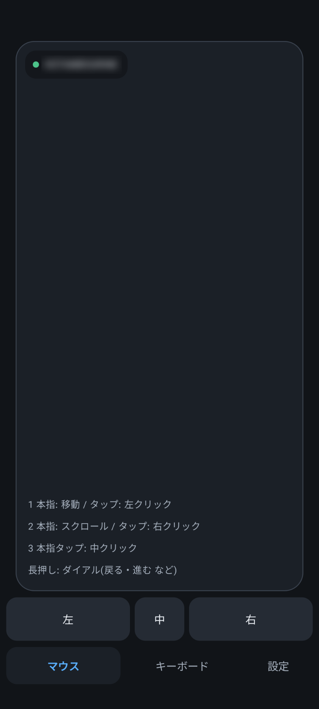

# PixelPilot

スマートフォンを PC のマウスにする Android アプリです。Bluetooth のマウスとして PC につながるので、**PC 側には何もインストールしなくて使えます。**



## できること(v2.0)

| 操作 | 動作 |
|---|---|
| 1 本指でなぞる | カーソル移動 |
| 1 本指でタップ | 左クリック(2 回でダブルクリック) |
| 2 本指でタップ | 右クリック |
| 3 本指でタップ | 中クリック |
| 2 本指でなぞる | スクロール(縦・横) |
| タップ直後に押したままなぞる | ドラッグ&ドロップ |
| 1 本指で長押し | 操作ダイアル。ずらして離すと 戻る(左)・進む(右)・中クリック(上)・右クリック(下) |
| 画面下部のボタン | 左・中・右クリック(押している間、押したまま) |

- 一度つないだ PC には、次からアプリを開くだけで自動で接続します
- 使っている間は画面を点けたままにします

キーボードと設定画面は v2.1 で追加する予定です。

## 動作環境

- **スマートフォン**: Android 9 以上で、Bluetooth HID(マウス・キーボードとしての接続)に対応した端末
  - メーカーがこの機能を無効にしている端末では使えません。その場合はアプリが案内を表示します
- **PC**: Windows・macOS(その他の OS は動作確認していません)

## 使い方

1. アプリを開き、「付近のデバイス」の許可を与える
2. 初めての PC は「新しい PC とペアリング」を押し、PC の Bluetooth 設定からこのスマホを追加する
3. つながるとマウスの画面になる。2 回目からは、前回の PC に自動で接続する

## 配布

- 開発版: main へのマージごとに Firebase App Distribution で配布しています(`docs/distribution.md`)
- 正式版: GitHub Releases で配布する予定です(#106)

## 開発

Kotlin Multiplatform / Compose Multiplatform で作っています。v2.0 のターゲットは Android のみで、iOS・デスクトップは今後対応します。

```sh
./gradlew assembleDebug     # ビルド
./gradlew test              # 単体テスト
./gradlew lint              # Android Lint
```

- ビルドには Android SDK が必要です。Bluetooth の挙動はエミュレーターでは確認できないため、実機で確認してください
- 設計: [`docs/design/v2.0.md`](./docs/design/v2.0.md)(方針)、[`docs/design/v2.0-standard.md`](./docs/design/v2.0-standard.md)(Android 単体版の詳細)
- モジュールは `model/`・`domain/`・`view/`・`transport/`・`androidApp/` に分けています。`app/` は v1.0 のコードで、v2.1 で削除します
